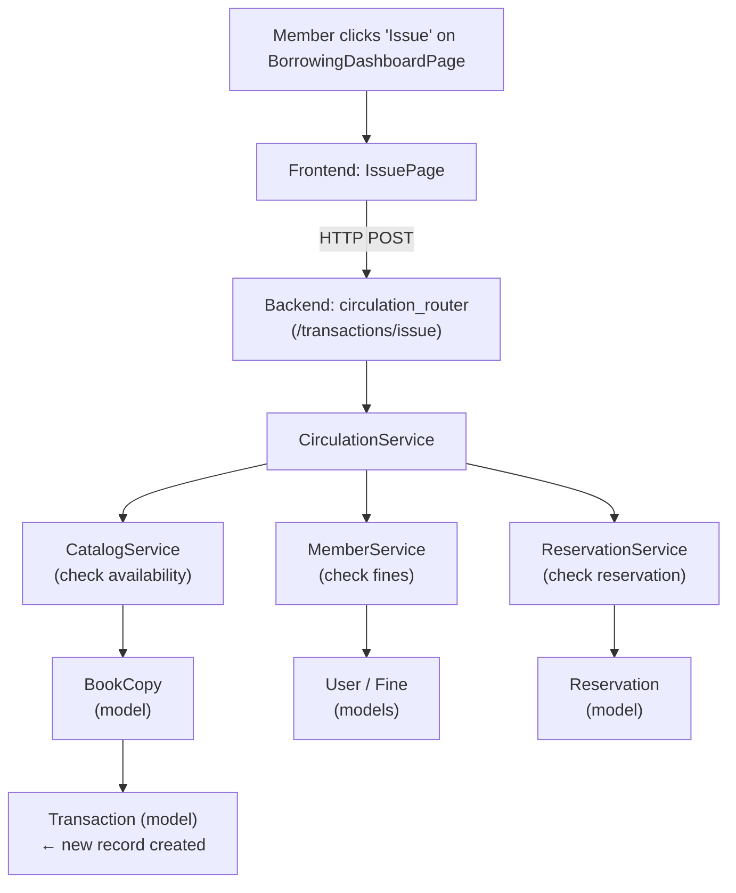
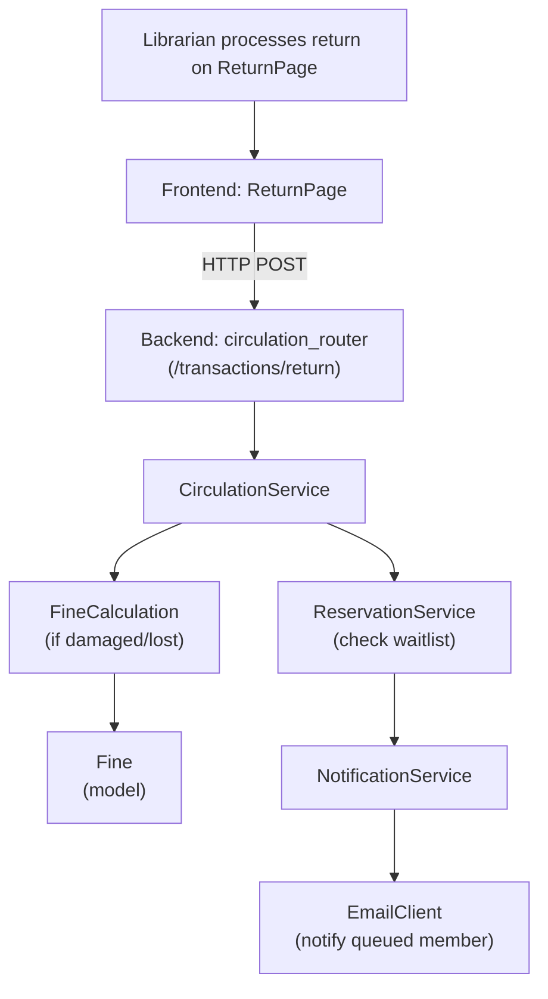
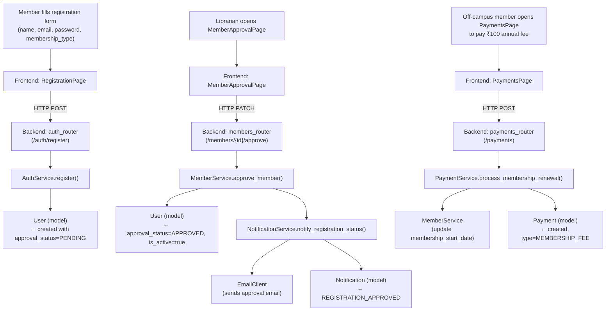
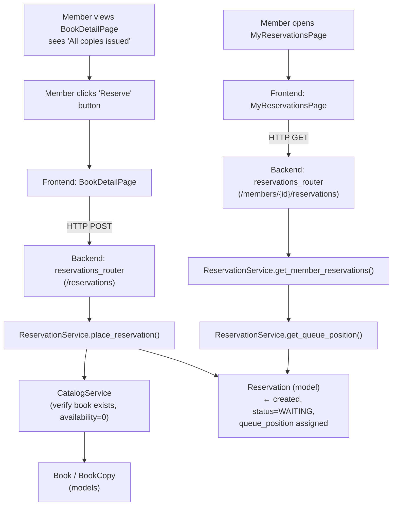
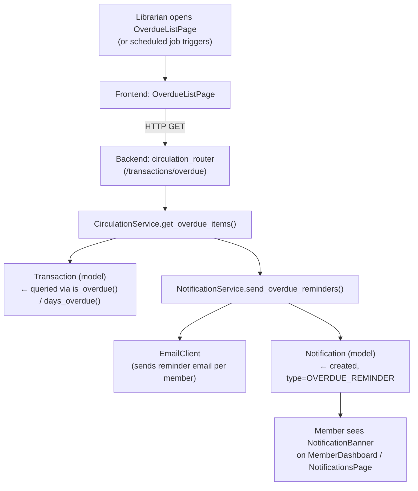
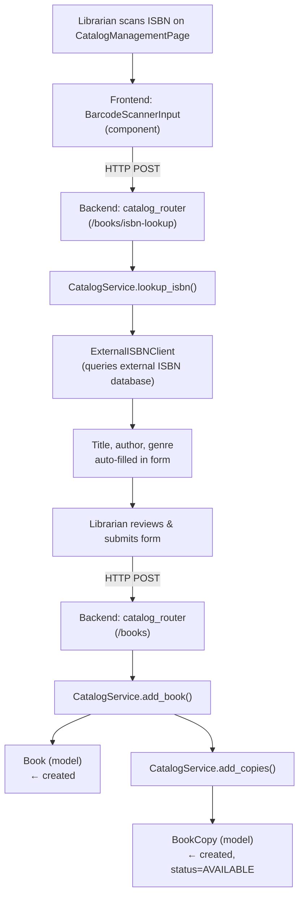
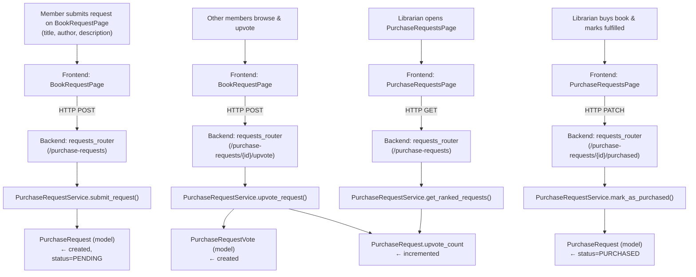
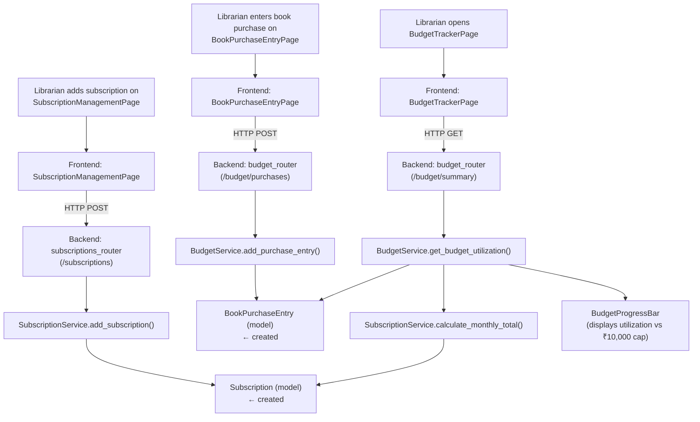
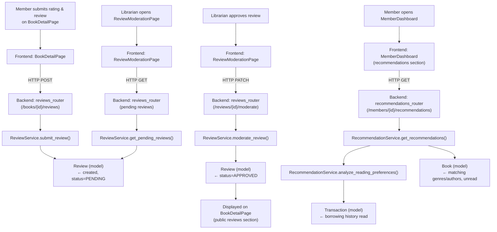
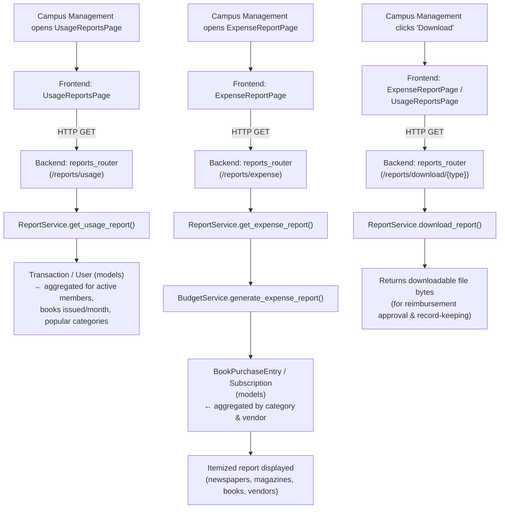

# Inter-Component Flow

## How Components Interact (Inter-Component Flow)

This document traces 10 representative workflows across the three tiers (Frontend → Backend → Database) of the Library Management System. Together, these workflows touch all 9 functional modules and the cross-cutting notification concern, demonstrating how the components defined in the sub-documents connect end-to-end.

| #   | Workflow                                             | Module(s) Covered                                               |
| --- | ---------------------------------------------------- | --------------------------------------------------------------- |
| 1   | Member Issues a Book                                 | Circulation                                                     |
| 2   | Book is Returned with Active Reservation             | Circulation, Reservation & Request, Notifications               |
| 3   | Member Self-Registration, Approval & Fee Payment     | Authentication & Identity, Membership Management, Notifications |
| 4   | Member Places a Reservation on an Unavailable Book   | Reservation & Request                                           |
| 5   | Overdue Detection & Automated Reminder Notifications | Circulation, Notifications                                      |
| 6   | Librarian Adds a Book via ISBN Barcode Scan          | Catalog & Inventory                                             |
| 7   | Member Purchase Request, Upvoting & Fulfillment      | Reservation & Request                                           |
| 8   | Subscription Management & Monthly Budget Tracking    | Budget & Subscription                                           |
| 9   | Review Submission, Moderation & Recommendations      | Community & Curation, Recommendations                           |
| 10  | Campus Management Reviews Usage & Expense Reports    | Reporting, Budget & Subscription                                |

---

### Workflow 1: Member Issues a Book

---

### Workflow 2: Book is Returned with Active Reservation

---

### Workflow 3: Member Self-Registration, Librarian Approval & Fee Payment

---

### Workflow 4: Member Places a Reservation on an Unavailable Book

---

### Workflow 5: Overdue Detection & Automated Reminder Notifications

---

### Workflow 6: Librarian Adds a Book to Catalog via ISBN Barcode Scan

---

### Workflow 7: Member Purchase Request, Community Upvoting & Fulfillment

---

### Workflow 8: Subscription Management & Monthly Budget Tracking

---

### Workflow 9: Review Submission, Moderation & Recommendation Update

---

### Workflow 10: Campus Management Reviews Usage & Expense Reports

