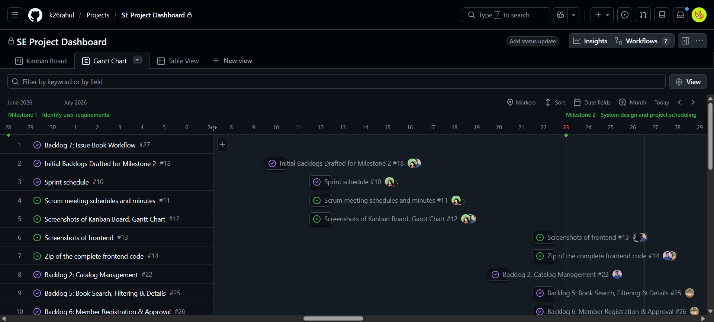
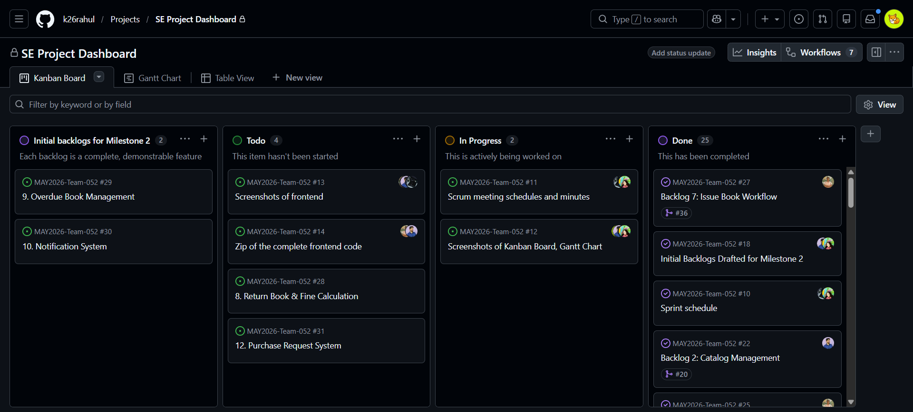
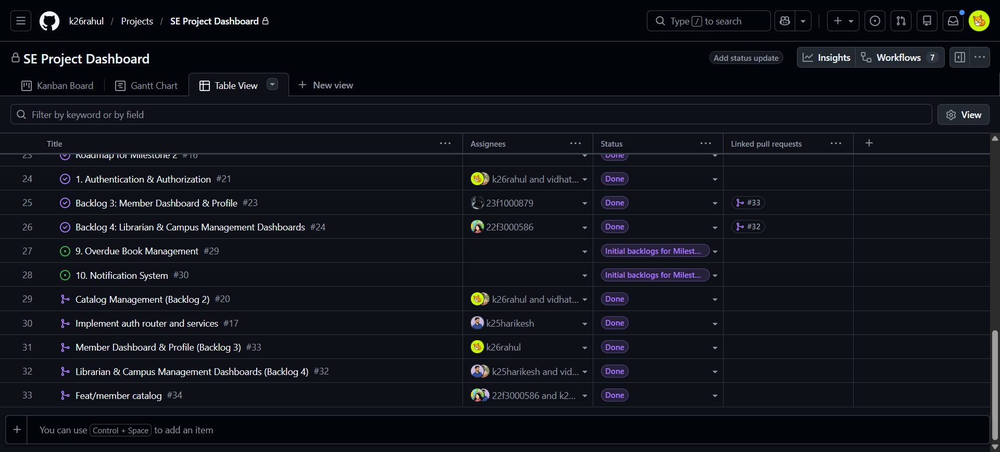
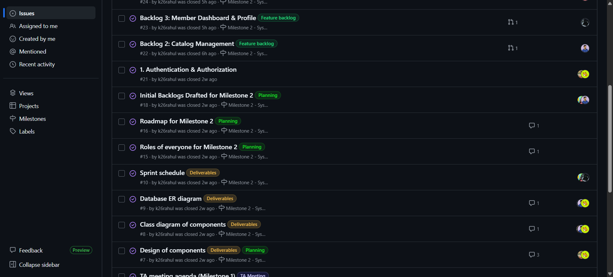
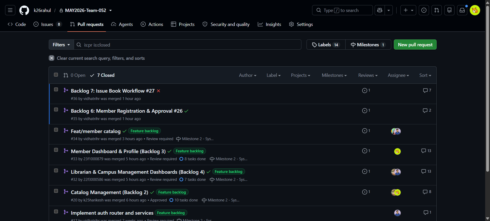

# Milestone 5: Final Report

**Project Name:** Library Management System
**Live Deployment Links:**

- Frontend: [Frontend](https://polite-fudge-f82b6c.netlify.app/)
- Backend (API Docs): [Backend](https://may2026-team-052.onrender.com/)

---

## 1. Introduction & Problem Statement

### Application Overview

We are building a **Library Management System** for the Rashtrotthana Vidya Kendra (RVK) campus library. This web application will transition the library from manual, paper-based operations — physical cards, registers, and verbal requests — into an automated, digital workflow system. The platform will manage memberships, book catalogs, issue/return cycles, reservation queues, budget tracking, and community features like book reviews and recommendations.

### The Current Landscape

- **Location:** Rashtrotthana Vidya Kendra (RVK) campus, which houses four distinct schools.
- **Inventory:** Approximately 5,000 books in the library catalog.
- **User Base:**
  - ~1,500 active campus students.
  - ~600 registered off-campus members from the outside community.

### The Core Problem & Pain Points

The RVK campus library currently operates on a **100% paper-based system**. Every workflow, from issuing books to managing reservations and budget tracking, is handled manually across multiple physical registers.

**For the Librarian:**

- **Membership:** Uses physical cards limited to ~20 entries. Overwhelming administrative overhead to replace cards.
- **Circulation & Fines:** Issues and returns are recorded in chronological registers. Tracking overdue books requires manual scanning of old pages. Calculating fines for lost/damaged books is manual.
- **Catalog:** No real-time availability. Registers only list owned books, not if they are currently on the shelf.
- **Budgeting & Subscriptions:** Relies on manual month-end tallies for book purchases and 10-15 magazine/newspaper subscriptions with varying frequencies against a ₹10,000 monthly allowance.

**For the Members:**

- **Discovery:** Must physically search rack-by-rack. No way to check availability before visiting.
- **Card Renewals:** Forced to return all issued books just to renew a full physical library card. Off-campus members pay ₹100 annually, tied rigidly to the academic year.
- **Reservations & Requests:** Verbal holds lead to an unfair, informal waitlist. Purchase requests lack visibility.

### The Digital Transformation Impact

- **Librarian:** Frees capacity by automating tracking, overdue alerts, waitlists, and budget tallies. Allows focus on curation and community engagement.
- **Members:** Provides instant digital discovery, automated and fair waitlists, continuous digital access without forced returns, and personalized recommendations.

---

## 2. Requirements Gathering

The requirements were collected through a multi-faceted approach led by the team:

1. **Informal Conversations:** Open-ended discussions with the librarian, members, and teachers about their day-to-day experiences and frustrations.
2. **Naturalistic Observation:** Firsthand observation of library operations, members searching the racks, and the campus accounting staff's budget reimbursement process.
3. **Formal Interviews:** Semi-structured, recorded interviews with the librarian and members focusing on specific workflows, pain points, and unmet needs.
4. **Secondary Research:** Studied general library management concepts (e.g., the librarian's role in encouraging reading culture) and analyzed existing software to identify standard features and potential improvements (like ISBN barcode scanning).

---

## 3. User Personas

### 3.1 Primary Users (Daily Interaction)

- **The Librarian (Core Administrator):**
  - Manages memberships, reviews/approves registrations.
  - Adds/updates the book catalog, tracks copies and conditions.
  - Digitally issues/returns books, processes fines.
  - Manages reservations, reading lists, and moderates reviews.
  - Records book purchases and manages subscriptions against the budget.
- **Library Members (On-campus and Off-campus Students):**
  - Self-register and manage their digital profiles.
  - Search the digital catalog and view real-time availability.
  - Monitor borrowed items, due dates, and pay fines/fees online.
  - Place reservations, request new books, submit reviews, and view personalized recommendations.

### 3.2 Secondary Users (Periodic Interaction)

- **Campus Management:**
  - View high-level reports and monitor library performance (usage, circulation).
  - Review and approve the month-end itemized expense report for the ₹10,000 budget reimbursement.

### 3.3 Tertiary Users (Indirect Impact)

- **School Teachers:** Benefit from curated reading lists supporting academics.
- **School Principal:** Uses library metrics for institutional assessment.
- **Book, Newspaper, & Magazine Vendors:** Supply materials based on the digital system's tracked purchase orders and subscription plans.

---

## 4. SMART User Stories

_The system features were derived directly from SMART (Specific, Measurable, Achievable, Relevant, Time-boxed) user stories._

**Librarian Highlights:**

- _As a Librarian, I want to securely log in to the administrative dashboard, so that I can manage library operations without unauthorized access._
- _As a Librarian, I want to scan a book's ISBN barcode when adding it to the catalog and have the system auto-fill the title, author, and genre, so that I don't have to type all the details manually._
- _As a Librarian, I want the system to automatically calculate the exact fine when I flag a returned book's condition, so that I can eliminate manual math errors._
- _As a Librarian, I want to see a real-time view of how much of the ₹10,000 monthly allowance has been used so far, so that I know how much is left to spend before the month ends._

**Member Highlights:**

- _As a Member, I want to search the digital catalog using filters (title, author, category), so that I can find books immediately without manually browsing racks._
- _As a Member, I want to click a "Reserve" button on a book that is currently out of stock, so that I can enter a fair, automated waitlist._
- _As a Member, I want to see book recommendations on my dashboard based on the genres and authors I have previously read, so that I can discover new books._

**Campus Management Highlights:**

- _As Campus Management, I want to view the month-end itemized expense report (broken down by newspapers, magazines, and books), so that I can verify the librarian's spending and approve the reimbursement amount._

---

## 5. Requirements Analysis & Feature Mapping

Based on the pain points and user stories, the system is organized into the following modules:

1. **Authentication & Identity:** Role-based access, member self-registration with librarian approval queue.
2. **Membership Management:** Digital profiles replacing 20-entry physical passbooks, automated 1-year billing cycles for off-campus members, and in-app payments.
3. **Catalog & Inventory:** Real-time availability, copy-level tracking (lost/damaged flags), and **ISBN Barcode Scanning** for auto-filling metadata (USP feature).
4. **Circulation (Issue/Return):** Instant transaction logging, automated deadline tracking (5, 10, 20, or 30 days), automated fine calculations, and automated overdue alerts.
5. **Reservation & Request:** Digital waitlist queue for out-of-stock books, availability alerts, and community **Book Purchase Requests with Upvoting** (USP feature).
6. **Community & Curation:** Digital reviews moderated by the librarian, and curated **Reading Lists** (USP feature).
7. **Recommendations:** **Personalized Book Recommendation System** based on reading history (USP feature).
8. **Budget & Subscription:** Centralized tracking of monthly subscription costs (calculating varied frequencies automatically) and book purchases against a running budget tracker.
9. **Reporting:** Month-end usage and expense reports for Campus Management.

---

## 6. System Design & Architecture

The application uses a modern, three-tier architecture separating the frontend single-page application, the backend REST API, and a relational database.

### 6.1 Backend Architecture

The backend is built with **FastAPI** and **Python 3.10**, following a strict layered architecture:

- **Routers (`routers/`):** Thin HTTP layer. Declares endpoints, parses requests using Pydantic schemas, and returns responses. No DB access or business logic is allowed here.
- **Services (`services/`):** Contains all business logic, performs database mutations, and raises HTTPExceptions.
- **Models (`models/`):** Defines DB tables via **SQLModel** (combining SQLAlchemy and Pydantic) and request/response DTO schemas.
- **Core (`core/`):** Cross-cutting concerns like DB engine, `pydantic-settings` for config, JWT auth utilities, and FastAPI dependency injection (e.g., `CurrentUserDep`, `LibrarianDep`).
- **Database:** **SQLite** (`library.db`) acts as the primary data store.
- **Authentication Flow:** JWT-based session management using `python-jose` and `pwdlib[bcrypt]`. Dependency injection is used for role enforcement.

### 6.2 Frontend Architecture

The frontend is a Single Page Application (SPA) built with **React 19** and **Vite**:

- **State Management:** Strict unidirectional data flow using **Zustand** for global state. Stores handle API calls and state updates.
- **UI & Styling:** **Tailwind CSS v4** and **shadcn/ui** components for a clean, accessible interface.
- **Data Fetching:** A shared **Axios** instance (`lib/api.js`) intercepts requests to attach JWTs. Pages never make direct API calls.
- **Mocking (MSW):** Uses **Mock Service Worker** for network-level API mocking during development, allowing UI development independent of the backend.
- **Routing:** Handled by **React Router DOM** with layout-based route protection (`AuthLayout`, `DashboardLayout` implementing role checks).

---

## 7. Tools and Technologies Used

| Layer                  | Tool                          | Purpose                                            |
| ---------------------- | ----------------------------- | -------------------------------------------------- |
| **Frontend Framework** | React 19                      | Component-based UI                                 |
| **Build Tool**         | Vite                          | Dev server + static production build               |
| **State Management**   | Zustand                       | Global client-side state management                |
| **Styling**            | Tailwind CSS v4               | Utility-first styling                              |
| **UI Components**      | shadcn/ui                     | Reusable, customizable UI primitives               |
| **Backend Framework**  | FastAPI                       | REST API, routers, auto-generated OpenAPI schema   |
| **Schema Validation**  | Pydantic                      | Request/response validation                        |
| **ORM**                | SQLModel                      | Database models + validation                       |
| **Database**           | SQLite                        | Persistent storage                                 |
| **JS Lint/Format**     | ESLint + Prettier             | Code quality and class sorting for frontend        |
| **Python Lint/Format** | Ruff                          | Fast code quality for backend                      |
| **Backend Testing**    | pytest                        | API and service-layer tests                        |
| **API Mocking**        | Mock Service Worker (MSW)     | API mocking to present UI without backend          |
| **Frontend Testing**   | Vitest, React Testing Library | Component and store-level tests                    |
| **E2E Testing**        | Playwright                    | Full user-flow browser tests                       |
| **Python Env**         | uv                            | Lightning-fast virtual env + dependency management |
| **CI / CD**            | GitHub Actions                | Enforce lint/format checks on PRs                  |

---

## 8. Implemented APIs & Testing Overview

Over 40 API endpoints were implemented across the following domains:

- **Authentication:** Registration, Login, Logout, Profile Fetch, Change Password.
- **Book Catalog:** List/Search, Add/Edit Book, ISBN Lookup, Copy Management.
- **Members:** Directory, Profile View, Approval/Rejection.
- **Circulation:** Issue/Return Books, Overdue Lists, Transaction Details, Fine Calculations.
- **Reservations:** Create Waitlist, Cancel, Alerts for Librarians.
- **Community:** Reviews, Reading Lists, Purchase Requests, Upvotes, Recommendations.
- **Budgeting & Reports:** Subscription management, Budget Summary, Expense Logging, Usage/Expense PDF Reports.
- **Payments:** Outstanding Fines, Membership Renewals.

**Test Suite:**
An exhaustive automated test suite was built using `pytest` for the backend. Over 61 test cases cover core authentication logic, API endpoints, business rules (like issue limits and fine calculations), and error scenarios (like duplicate emails and forbidden access).

---

## 9. User Feedback Summaries

Stakeholder feedback gathered during Sprint demonstrations highlighted the impact of the system:

- **Librarian:** Emphasized the massive time-savings from digital issue/returns and instant overdue lookups. The automated waitlist resolved disputes over high-demand books. Budget tracking consolidated fragmented Excel sheets.
- **Members (Students):** Appreciated the digital catalog filters saving physical browsing time. Dashboard due-date visibility prevented unexpected fines. Features like personalized recommendations and book purchase upvoting created a sense of community engagement.
- **Campus Management:** Noted that the dashboard and automated monthly expense reports made auditing the ₹10,000 allowance transparent and straightforward.

---

## 10. Setup and Build/Run Instructions

### Backend Setup

1. **Install `uv`:** Ensure the `uv` package manager is installed on your machine.
2. **Install Dependencies:** Run `uv sync` to create the virtual environment (`.venv`) and install dependencies from `uv.lock`.
3. **Start Development Server:**
   ```bash
   uv run uvicorn main:app --reload --port 8000
   ```
   The API will be available at `http://localhost:8000` with interactive docs at `http://localhost:8000/docs`.
4. **Testing & Linting:**
   - Tests: `uv run pytest`
   - Linting: `uv run ruff check .`
   - Formatting: `uv run ruff format .`

### Frontend Setup

1. **Install Node.js:** Ensure Node.js is installed.
2. **Install Dependencies:**
   ```bash
   npm install
   ```
3. **Start Development Server:**
   - With API Mocking (MSW): `npm run dev`
   - With Real Backend: `npm run dev:no-mock`
     The app will be accessible at `http://localhost:5173`.
4. **Build for Production:**
   ```bash
   npm run build
   ```
5. **Testing & Linting:**
   - Tests: `npm run test`
   - Linting: `npm run lint`
   - Formatting: `npm run format`

---

## 11. Issue Tracking & GitHub Projects

### Gantt Chart


### Kanban Board


### Table View


### Issues


### Pull Requests

