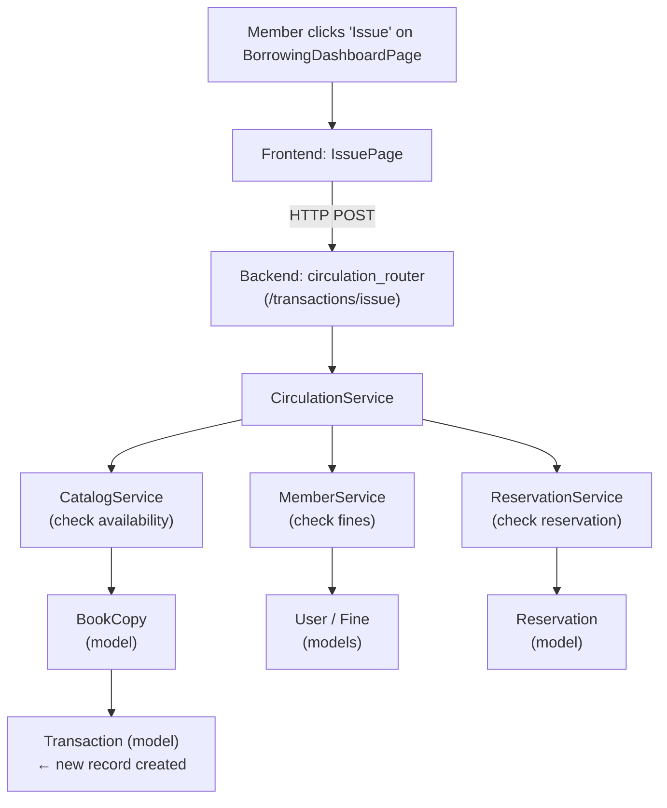
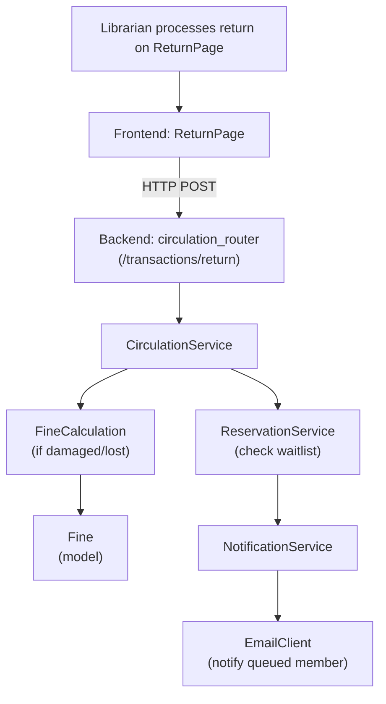

# Inter-Component Flow

## How Components Interact (Inter-Component Flow)

Here is how the components connect across the three tiers for key workflows:

### Workflow: Member Issues a Book

### Workflow: Book is Returned with Active Reservation

